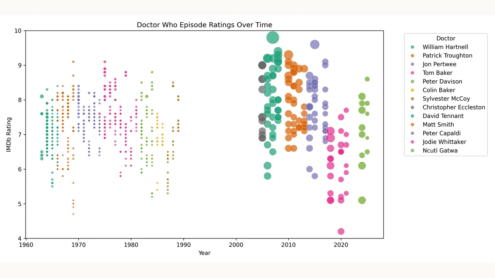

# Rating the Regenerations

An interactive look at the IMDb ratings of every regular *Doctor Who* episode since 1963. Visitors follow the ratings across the show's history, find any episode in a season-by-episode heatmap, and rank the Doctors, writers or directors. They can then change the assumptions behind the ranking and watch the order move: how stories are averaged, how far small samples are pulled towards the overall mean, and whether each era is judged against its own average. The answer to "Who is the best Doctor?" depends on how you count.

The project is descriptive: it shows how episodes were rated, not why.

**Status:** being rebuilt. The demo bundle currently released for the site is a stub. The plan, design decisions and milestones are in [docs/plan.md](docs/plan.md). The write-up and the demo will live together at [mark-bugden.github.io/projects/doctor-who-ratings](https://mark-bugden.github.io/projects/doctor-who-ratings/), which is published once the demo is past the stub.



## Repository layout

| Path | What it is |
| --- | --- |
| [`demo/`](demo/) | The interactive demo for [mark-bugden.github.io](https://mark-bugden.github.io/), built with [demo-kit](https://github.com/Mark-Bugden/demo-kit). Its README explains how to run and build it. |
| [`src/doctor_who_ratings/`](src/doctor_who_ratings/) | Python: the data pipeline and the leaderboard's reference maths, from step 2 of the plan. |
| [`docs/`](docs/) | The plan, and later the write-up. |
| [`legacy/`](legacy/) | The original 2025 notebook, kept for reference. Its README explains why its variance analysis doesn't hold. |

## Running the demo

```sh
cd demo
npm install
npm run dev
```

## Python

The Python side is a [uv](https://docs.astral.sh/uv/) project. The data pipeline arrives with step 2 of the plan. For now, `uv sync` sets up the environment, and `uv run pre-commit install` installs the hook that strips notebook outputs before each commit.

## Data

The demo combines two sources:

- **Ratings** come from IMDb's [non-commercial datasets](https://developer.imdb.com/non-commercial-datasets/), used under their terms for personal and non-commercial use. The raw dumps are never committed, and the demo carries only the fields its views need.

  > Information courtesy of IMDb (https://www.imdb.com). Used with permission.

- **Stories, air dates, writers and directors** come from Wikipedia's [List of Doctor Who episodes (1963–1989)](https://en.wikipedia.org/wiki/List_of_Doctor_Who_episodes_(1963%E2%80%931989)) and [List of Doctor Who episodes (2005–2025)](https://en.wikipedia.org/wiki/List_of_Doctor_Who_episodes_(2005%E2%80%932025)), under [CC BY-SA 4.0](https://creativecommons.org/licenses/by-sa/4.0/).

## Licence

The code is under the [MIT License](LICENSE). The data is not covered by it: IMDb's data stays under IMDb's terms, and data taken from Wikipedia stays under CC BY-SA 4.0.

## History

The project started in March 2025 as a Jupyter notebook, written up as the blog post "Directing the Doctor". In November 2026 it was rebuilt as an interactive browser demo and renamed "Rating the Regenerations". The repository history was rewritten at the same time to remove a committed Python virtual environment. The notebook remains in [`legacy/`](legacy/).
